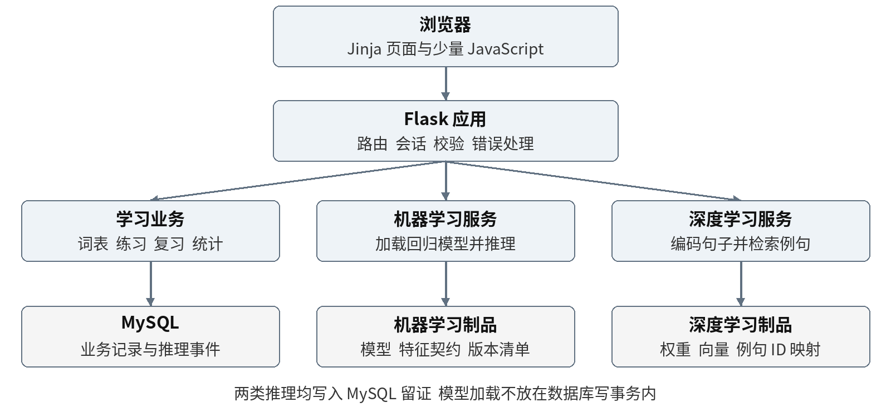

# 一个 Flask 应用，三条独立业务路径

采用模块化单体：页面、学习业务与模型推理位于同一 Python 应用，按职责组织，而非拆为独立微服务。课程要求能够直接展示路由、SQL、事务和模型加载过程。

图源：交接报告 v1.0，图 1。图中的模型模块位于同一 Flask 应用内。

## 职责与依赖

| 位置 | 负责 | 不负责 |
| --- | --- | --- |
| `app/__init__.py` | 应用工厂、配置、扩展和路由注册 | 训练模型、连接并迁移数据库 |
| `app/blueprints/` | auth、learning、admin、lab 的 HTTP 入口、身份与输入校验 | SQL 拼接、客户端判分 |
| `app/services/` | 练习事务、判分、复习规则、内容导入、模型调用 | 模板渲染、读取客户端伪造身份 |
| `app/repositories/` | 参数化 SQL、行锁、数据读写与连接管理 | 隐式提交、模型推理 |
| `app/templates/`、`app/static/` | Jinja 页面、同源交互与静态图片 | 标准答案泄漏、可信成绩计算 |
| `ml/` | 特征转换、训练、评价、向量构建 | 在页面请求中训练或下载模型 |
| `artifacts/` | 本地受信任模型、向量、版本清单 | 密钥或业务事实存储 |
| `sql/` | 建表、顺序迁移、演示种子 | 重置真实用户数据库 |
| `evidence/` | 真实运行材料及索引 | 预填成功结果或虚构模型指标 |

当前只注册 lab Blueprint 和首页；其余职责已定，业务入口后续实现。直接依赖先收敛到 Flask、PyMySQL、Flask-WTF 与 dotenv；算法依赖在相应阶段验证并锁定。

## 三个必须守住的契约

**历史归事实所有。** `attempts` 是作答事实，`learning_state` 是可重建投影，模型输出只进入 `inference_events`。切换考试词表仅改变目标关联，不删除历史。词义和题型没有记录时显示未测试。

**一题一次有效提交。** 服务端验证归属，按固定顺序加锁；作答与统计在同一事务提交。标准化答案相同的重试返回原结果，不同答案返回冲突；真正重练生成新题目实例。细节见 [接口契约](api.md)。

**模型是可独立失败的能力。** 基础页面和学习业务启动不要求模型文件存在。模型按实际使用进程加载一次，Web 请求不训练、不下载；推理、文件读取不进入学习写事务。缺失或版本不匹配时模型接口返回 503，不回退为伪造结果。数据与特征契约见 [模型契约](models.md)。

## 运行与配置

开发在 Osaka Linux ARM64；Mac 浏览器经 SSH 隧道验收。普通演示先用 CPU；本次未运行训练、深度推理或 CUDA 验证。首版不要求公网部署，Flask 开发服务器只用于本地/隧道演示。

数据库目标为 MySQL 8.x、InnoDB、utf8mb4。未来测试使用独立测试库；生产/演示配置和测试配置分开。配置项及空值说明见 `.env.example`。当前应用只消费 Web 配置；DB 和模型项在对应能力实现时接入。

`SECRET_KEY`、数据库密码不进入 Git 或截图。Cookie 使用 HttpOnly、SameSite=Lax；APP_ENV=production 时启用 Secure，需配合 HTTPS。当前两个 GET 页面无需会话密钥；引入账户前必须验证密钥配置。写接口使用 CSRF，Jinja 保持自动转义。

## 文件与大数据

Git 只保存代码、契约、经授权的演示内容与经过隐私检查的实验证据。`.env`、原始训练集、个人学习日志、模型权重和向量不提交。`artifacts/` 只跟踪说明文件，运行时在本地准备制品；未来清单仅登记实际验证过的版本与哈希。
