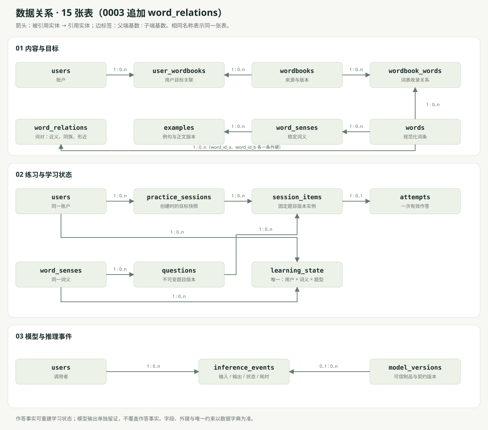

# 数据模型

以下为 MySQL 数据字典，由 `sql/migrations/` 下按序迁移创建；内容导入规则见 [内容包格式](content-format.md)；`schema_migrations` 记录已执行迁移，属于基础设施表，不计入 14 张业务表。使用 InnoDB、utf8mb4；除注明的复合键外主键为 BIGINT。时间保存为 UTC DATETIME(6)，展示和日统计按用户时区转换。所有外键类型一致并建索引，默认限制删除。

## 账户与内容

| 表 | 字段 | 键与约束 |
| --- | --- | --- |
| users | id, username, username_norm, password_hash, role, is_active, display_timezone, created_at | username_norm 唯一；role=learner/admin；password_hash VARCHAR(255) |
| wordbooks | id, code, exam_type, name, source, version, is_active, created_at | (code,version) 唯一；exam_type=cet6/postgraduate/ielts；来源版本必填 |
| words | id, language, lemma, lemma_norm, phonetic, is_active | (language,lemma_norm) 唯一；首版 language=en；保留显示形式 |
| word_senses | id, word_id, sense_key, part_of_speech, definition_zh, definition_en, is_active | FK word_id；(word_id,sense_key) 唯一；sense_key 稳定 |
| wordbook_words | wordbook_id, word_id, position, source_note | 复合主键 (wordbook_id,word_id)；两个外键；不推断词义覆盖 |
| user_wordbooks | user_id, wordbook_id, selected_at | 复合主键 (user_id,wordbook_id)；切换仅修改关联 |
| examples | id, example_key, sense_id, text_en, translation_zh, source, content_version, is_active | example_key 唯一（0002 迁移），供重复导入与 DL 标注引用；FK sense_id；每条例句一个目标词义；正文版本与向量一致 |

## 练习、学习与推理

| 表 | 字段 | 键与约束 |
| --- | --- | --- |
| questions | id, logical_key, version, sense_id, skill_type, prompt, options_json, answers_json, grading_policy_json, status | (logical_key,version) 唯一；id 是不可变题目版本；skill_type 为三类题型 |
| practice_sessions | id, user_id, target_snapshot_json, status, started_at, finished_at | FK user_id；status=active/completed/abandoned；保存目标快照 |
| session_items | id, session_id, question_id, position, issued_at, submitted_at | FK session_id/question_id；(session_id,position) 唯一 |
| attempts | id, session_item_id, raw_answer_json, normalized_answer, is_correct, error_type, review_rule_version, submitted_at | session_item_id 唯一；用户和词义从练习与题目推导 |
| learning_state | id, user_id, sense_id, skill_type, seen_count, correct_count, correct_streak, interval_stage, last_attempt_at, next_review_at | (user_id,sense_id,skill_type) 唯一；0≤correct_count≤seen_count；由 attempts 重建 |
| model_versions | id, kind, model_code, version, artifact_sha256, feature_schema_version, metadata_json, status | (model_code,version) 唯一；kind=ml/dl；记录数据、环境与制品版本 |
| inference_events | id, request_id, user_id, model_version_id, kind, source_type, input_json, output_json, status, model_time_ms, processing_time_ms, created_at | 模型加载失败允许 model_version_id 为 NULL；禁止存密码/会话密钥 |

`attempts` 保存事实，`learning_state` 保存投影；模型输出不改写二者。source_type 区分 manual_lab、source_test、user_history；个人日志适配未实现，不生成虚构的 user_history 效果记录。

## 迁移中确定的取值

- 枚举型字段用 VARCHAR 加 CHECK：questions.status=published/retired；model_versions.status=active/retired；inference_events.source_type=manual_lab/source_test/user_history。
- attempts：正确时 error_type 为 NULL，错误时必须给出 error_type。
- learning_state：0≤correct_streak≤correct_count≤seen_count，interval_stage 为 0—3。
- inference_events.user_id 可为 NULL，供无登录用户的 source_test 记录使用。
- username_norm、lemma_norm、sense_key、logical_key 等标识列使用 utf8mb4_bin，规范化由应用完成，避免排序规则把重音或大小写不同的值视为重复。
- 时间列没有数据库默认值，统一由应用 clock 写入 UTC。

## 索引与历史

外键均建索引。优先增加 wordbooks(exam_type,is_active)、examples(sense_id,is_active)、learning_state(user_id,next_review_at)、practice_sessions(user_id,started_at)、inference_events(user_id,created_at)，再用真实查询 EXPLAIN 检查。

已引用的词条、词义、例句、题目和模型版本保留历史或停用，不级联删除。已发布题目更新必须新增版本。关系字段不使用逗号拼接 ID；选项等结构化内容可用 JSON。

## 学习状态与 review_rules_v1

- 无有效作答：未测试，不赋虚构分数。
- next_review_at≤当前时间：待复习；错题未到期可列出，但显示倒计时。
- 连续三次正确且跨度≥24 小时：近期作答稳定；跨度从作答事实查询，不仅凭 correct_streak 判断。
- 错误：correct_streak 清零，interval_stage=0，10 分钟后复习。
- 正确：按当前 interval_stage 取 [1,3,7,14] 天间隔，之后阶段加一并封顶 3；初始阶段为 0。
- 重建按 (submitted_at,attempt_id) 排序，使用作答记录保存的规则版本；变更规则保留旧版或记录完整迁移。`flask rebuild-learning-state [--username U] [--apply]` 执行重放并逐字段比对，有差异时退出码为 1，`--apply` 把差异行改写为重放结果；遇到未登记的规则版本即中止。应在无人练习时执行。
- 近期作答稳定：同一用户、词义、题型最近三次作答均正确，且第一次与第三次的 submitted_at 相差不少于 24 小时。

词表交集按 words 去重；题型表现按词义与题型统计，两种分母分别标明。某词收录于词表不等于考试覆盖该词全部词义。
